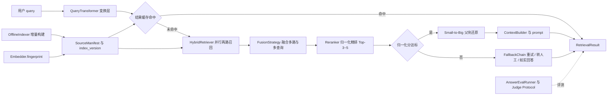

# RAG 框架改进方案（v2 · 已按评审结论 B 优化）

> **状态：已按评审结论 B 优化，待确认执行** — 评审结论为「B 需优化方案，优化后可直接进入实施，无需重新全量评审」。本轮**仅依据评审意见逐条调整方案文档，零代码改动、零 plan 执行**。确认后按 P0 → P1 实施。
>
> | 项 | 内容 |
> |---|---|
> | 依据 | [`RAG实现全面评估报告.md`](RAG实现全面评估报告.md)（2026-11-05） |
> | 优化依据 | [`RAG框架改进方案评审意见.md`](RAG框架改进方案评审意见.md)（2026-11-05，结论 B） |
> | 改造对象 | `cn/mcheat/rag/`（现有 58 个源文件、122 个单元测试） |
> | 方案标识 | `rag-p0-p1-upgrade`（plan v1） |
> | 文档版本 | **v2**（v1 为待评审稿；本次按评审意见优化） |
> | 编制 / 优化日期 | 2026-11-05 |
> | 范围 | 报告 P0 + P1；P2 与报告缺失项 #9~#12 列为后续路线 |
> | 本轮交付 | 本文档 v2；**零代码改动、零 plan 执行** |
>
> **本次优化的可追溯总表见 [附录 C](#附录-c评审意见逐条落实表v1--v2)**；v1 中被评审明确认可的内容（附录 A 15 条证据、增量发现、第二章一致性判断、第三章三个亮点、4.2 已识别风险、第五章「做得好的」、报告 12 项映射表等）**原样保留，未作改动**。

---

## 目录

1. [评审摘要与待决策项](#一评审摘要与待决策项)
2. [问题归因分析](#二问题归因分析)
3. [目标与非目标](#三目标与非目标)
4. [总体设计](#四总体设计)
5. [关键技术决策](#五关键技术决策)
6. [分阶段实施计划](#六分阶段实施计划)
7. [改动文件清单](#七改动文件清单)
8. [接口与配置变更](#八接口与配置变更)
9. [评测与验收](#九评测与验收)
10. [风险、开关与回滚](#十风险开关与回滚)
11. [后续路线](#十一后续路线本轮不做)
12. [附录 A：代码证据索引](#附录-a代码证据索引)
13. [附录 B：评审结论落实与下一步](#附录-b评审结论落实与下一步)
14. [附录 C：评审意见逐条落实表（v1 → v2）](#附录-c评审意见逐条落实表v1--v2)

---

## 一、评审摘要与待决策项

### 1.1 一句话结论

现有框架**架构骨架正确**（两段式 Top-K、Small-to-Big、分阶段度量、可观测兜底），主要风险集中在两处「使用者最信任的默认配置路径」上：**质量门禁实际关闭**与**模型语言域错配**；此外可插拔路径上存在**跨组件分数契约不一致**与**索引写放大**。方案按「契约先行 → 标定数据先行 → P0 → P1」推进，全部新增能力做成可选组件，保证零依赖默认档可跑、122 个既有测试全绿。

### 1.2 三项 P0 生产阻断项

| # | 问题 | 后果 | 修复要点 |
|:-:|---|---|---|
| P0-1 | `min_best_score = 0.0`，且三个精排器分数域互不相同 | 只要召回条数达标，**任何垃圾结果都会进 prompt**；换精排器后阈值语义直接失效 | `Reranker` 接口层统一归一化契约 + 负样本标定非零阈值 |
| P0-2 | 默认/推荐 embedding 与 reranker 均为英文域模型；`embed_query` / `embed_documents` 无前缀 | 按 README「一键切生产」后中文检索质量不升反降 | 中文 BGE 模型 + query/passage 前缀 + 独立生产配置档 + 模型指纹校验 |
| P0-3 | `FileBackedVectorStore` 默认 `auto_save=True`，每批 `upsert` 全量重写 JSON | 建索引近似 O(N²) 磁盘 IO，10 万块即数千次重写 | 构建期关闭自动写、结束单次 `flush()`；新增 SQLite 二进制向量库 |

### 1.3 已确认的三条边界（需求澄清结论）

| 边界 | 结论 |
|---|---|
| **范围** | P0 + P1；包含为 P0 阈值标定所必需的**负样本与归一化契约**；不含 P2 |
| **零依赖默认** | 保留 `defaults.json` 的 `hashing` / `lexical` 默认，新增 `configs/production.json` 补丁档；切换模型必须重建索引并重跑基线 |
| **LLM 能力** | 查询改写 / HyDE / LLM-as-judge **仅定义 Protocol + 规则型零依赖兜底**，不接项目 `llm.py`、不绑定厂商、不需要 API key |

### 1.4 实施节奏与验收

7 个阶段，依赖关系为严格串行（见 [第六章](#六分阶段实施计划)）：

```
P0-1 归一化与门禁 ──> P0-2 中文嵌入/生产档/指纹 ──> P0-3 写放大/SQLite
   ──> P1-1 查询变换与缓存 ──> P1-2 增量索引 ──> P1-3 答案级评测 ──> P1-4 并行化/服务化/文档
```

**全局验收标准**：`python -m unittest discover -s cn/mcheat/rag/tests -t . -p "test_*.py"` 全绿；`run_evaluation --gate` 通过；默认档 demo 在干净环境（无可选依赖）仍可直接运行；旧索引产物可加载（仅 WARN）。

### 1.5 决策项与本次评审结论

> v1 的 12 个决策项（D1~D12）经本次评审**全部同意**；下表仅记录评审附加的前提与调整，其余建议与备选说明保持 v1 原文。

| ID | 决策点 | 方案建议（v2） | 主要影响 / 备选 |
|---|---|---|---|
| **D1** | 质量门禁的实现层次 | 在 `Reranker` 接口新增 `normalize_scores()` 契约，而非只给 `CrossEncoderReranker` 加 sigmoid | 多改 3 个文件，但换来可插拔路径上阈值语义一致；备选「仅 CE sigmoid」会让 `NoopReranker` 与 `lexical` 仍不在同一值域 |
| **D2** | `ScoredChunk.score` 语义变更 | `score` 改为恒为 `[0,1]` 归一化分，新增 `raw_score` 保留原值 | **评审结论：同意，前提是 Q5 确认无框架外调用方读取 `ScoredChunk.score`**；若存在，改走「新增 `normalized_score` 字段」的完全兼容备选（见 [10.4](#104-实施前置确认项q1--q5)） |
| **D3** | `LexicalOverlapReranker` 移除 prior 地板 | 把 `0.1 * (1 - i/n)` 从最终分中移除、仅作同分 tie-break | 归一化后可分性变好，但**所有既有分数断言会变化**，需同步更新测试；当前无关查询也有 0.38~0.44 的保底分。**评审补充核验：`test_07` 全为顺序断言、`test_09` 用关键字构造，实际爆炸半径小于本方案自述** |
| **D4** | `min_best_score` 默认值 | **初值定 0.35 作为待验证起点**，用 `--sweep-threshold` 在含负样本的 Golden Set 上扫描（覆盖 `0.0~0.8`），确认 8 条正样本零误杀后写入 `defaults.json` | 以扫描结果为准，**0.35 不是拍板值**；阈值为暂行值，Golden Set 扩至 30~50 条后须复标（见 [9.1](#91-阈值标定流程p0-1-前置)） |
| **D5** | 生产档模型选型 | embedder `BAAI/bge-m3`（中英混合）、reranker `BAAI/bge-reranker-large` | 备选 `BAAI/bge-large-zh-v1.5`（纯中文、体积更小）；`ms-marco` / `all-MiniLM` 一律不再作为推荐值 |
| **D6** | 配置档加载方式 | 新增 `configs/production.json` + `RAG_PROFILE` 环境变量 / `load_profile()` | 生产档必须为每个「换实现」的组件**显式写全 params**（现有 `_reconcile_component_params` 会丢弃继承参数） |
| **D7** | `FileBackedVectorStore.auto_save` 默认值 | 由 `True` 改为 `False`，由 `OfflineIndexer` 统一 `flush()` | **评审结论：同意，但须把 `tests/test_05_embeddings_vectorstore.py` 补进测试改动清单**（该测试依赖 `auto_save=True`，否则必挂，见 [10.2 风险表](#102-主要风险与缓解)）；对直接使用该类的调用方是语义变更，需在 README 显著标注 |
| **D8** | 可选组件注入机制 | 新增 `OPTIONAL_COMPONENTS`，`BUILD_ORDER` 前置插入但 `REQUIRED_COMPONENTS` 保持不变 | 保护旧配置 / 旧基线 / 旧产物；备选「加进必需组件」会破坏所有旧配置 |
| **D9** | 增量索引默认模式 | `RAGSystem.index(..., mode="auto")`：无 manifest 时全量、有则增量 | 保持现有 `test_index_is_idempotent` 语义；`mode="full"` 可强制全量 |
| **D10** | 并行召回默认开关 | **改为默认关闭；由生产档 / 服务化显式开启** | 评审指出默认栈两路均为纯 Python CPU-bound（哈希 embedding + BM25 扫描），受 GIL 限制线程并行无收益甚至更慢；`max(T_dense, T_sparse)` 仅在 I/O-bound（API embedding）时成立。原「默认开启」降级为生产档选项 |
| **D11** | 缓存失效键 | 两级缓存 key 均含 `index_version`（每次成功 `index()` 递增） | 备选「用 `created_at`」存在同秒更新风险 |
| **D12** | LLM 能力边界 | 仅 Protocol 注入 + 规则型兜底，框架边界仍止于 `result.prompt`，不代跑 LLM | 与用户澄清结论一致；若评审希望接入 `llm.py` 需重新评估零依赖约束 |

> 评审结论（逐字采纳）：`D1=同意 / D2=同意（前提：Q5 确认无外部依赖）/ D3=同意（实测影响小于自述）/ D4=初值定 0.35 待扫描验证 / D5=同意 bge-m3 / D6=同意 / D7=同意（须补 test_05 进改动清单）/ D8=同意 / D9=同意 / D10=建议改默认关 / D11=同意 / D12=同意`。Q1~Q7 的处置见 [10.4 实施前置确认项](#104-实施前置确认项q1--q5) 与 [附录 C](#附录-c评审意见逐条落实表v1--v2)。

---

## 二、问题归因分析

把报告的 12 项缺失与本轮核对发现的额外缺陷，按根因归为四类。

### A 类：默认配置路径缺陷（最危险）

| 缺陷 | 代码证据 | 影响 |
|---|---|---|
| **质量门禁实际关闭** | `configs/defaults.json:87` `"min_best_score": 0.0`；`retrieval/fallback.py:53` `max(scores) < min_best_score`，而分数恒非负 | 只要 `coarse_count >= 3`，任何垃圾结果都会判定 `answer_ready=True` 并生成 prompt。幻觉控制只剩「数量阈值」一道防线 |
| **模型语言域错配** | `embeddings/adapters.py:42`、`retrieval/recall.py:98` 默认 `sentence-transformers/all-MiniLM-L6-v2`；`retrieval/rerank.py` 默认 `cross-encoder/ms-marco-MiniLM-L-6-v2` | 分词器、清洗规则、示例语料全为中文优先；按 README 第 6 节切换后中文质量不升反降 |
| **索引写放大** | `vectorstores/memory.py:167` `auto_save=True`；`:177-179` 每批 `upsert` 后 `flush()`；`:188` `flush()` 调用 `super().export_state()` 全量序列化 | 10 万子块 / batch 32 ≈ 3000+ 次全量 JSON 重写，越写越慢 |

### B 类：跨组件契约缺陷（可插拔路径必然踩坑）

1. **精排分数域不统一**：`LexicalOverlapReranker` 约 `0.38~0.53`（含 prior 地板）、`CrossEncoderReranker` 直通原始 logit（约 `[-10,10]`）、`NoopReranker` 用 RRF 分（约 `0.016`）；而 `config.py:308` 强制 `min_best_score ∈ [0,1]`。**只给 CE 加 sigmoid 不足以解决**，必须在接口层建立统一契约。
2. **`Embedder` 接口承诺未兑现**：接口刻意区分 `embed_query` / `embed_documents`，但 `LangChainEmbedder` 直接透传，不支持 BGE / E5 的 query / passage 前缀。
3. **换模型防护不完整**：`DimensionMismatchError` 只挡维度不一致；同维度换模型会静默混用新旧向量。`IndexArtifact` 无模型指纹、无 `index_version`。
4. **阈值无法标定**：`examples/golden_set.json` 8 条全是可回答查询；`evaluation/metrics.py` 全是检索指标，`GATED_METRICS` 不含任何拒答指标。报告建议的「0.3~0.5 扫描」**缺少数据基础**，这是 P0-1 能否落地的前置条件。
5. **`RetrievalResult.coarse` 分数域未在契约中说明**（本次评审补充）：`retrieval/pipeline.py:119-128` 构造 coarse `ScoredChunk` 时直接使用 RRF 融合分（约 `1/(k+rank)`，≈0.016 量级）。D2 改造后 `final[i].score ∈ [0,1]` 而 `coarse[i].score` 仍为 RRF 域，两套量纲并存。**处置见 [8.1 接口约定](#81-关键接口仅签名级)**：明确为有意为之并在接口文档中标注，不纳入统一契约。

### C 类：能力缺失

查询变换层（改写 / 多查询扩展 / HyDE）、查询向量 LRU 缓存与结果 TTL 缓存、文档级增量索引与 `delete_by_source`、生成侧评测（Faithfulness / Answer Relevancy）、并行召回、阶段耗时分解、线程安全契约。

### D 类：规模化性能

| 位置 | 现象 |
|---|---|
| `retrieval/hybrid.py:195` | `for source, retriever, k in paths:` 两路召回串行 |
| `retrieval/context.py:167` | 预算裁剪 `while` 循环内反复调用 `_total_length()`，每次完整渲染所有块 |
| `retrieval/pipeline.py` | `widen_top_k` 重试回到循环头部重跑完整两路召回 + 精排，最多 3 倍调用成本，无预算控制 |
| `retrieval/bm25.py` | 注释称「倒排索引」，实际线性遍历所有 chunk 的 tf 字典（P2 处理） |

### 报告 12 项缺失 → 根因映射

| 报告 # | 缺失能力 | 归类 | 本方案处理 |
|:-:|---|:-:|---|
| 1 | 语义嵌入（默认配置） | A | P0-2（生产档 + 中文模型，默认档保留零依赖） |
| 2 | 质量阈值跨精排器归一化 | A/B | P0-1（接口契约 + 标定） |
| 3 | 查询变换层 | C | P1-1 |
| 4 | 缓存 | C | P1-1 |
| 5 | 增量索引 | C | P1-2 |
| 6 | 生成侧评测 | C | P1-3 |
| 7 | 并发与线程安全 | C/D | P1-4 |
| 8 | 结构感知切分 / 标题增强 | — | **P2，不在本轮** |
| 9 | embedding API 重试/限流 | — | **不在本轮**（但与生产档有交叉，见 [第十一章 #9 注记](#十一后续路线本轮不做)） |
| 10 | 聚合可观测性（OTel） | — | **不在本轮**（仅做阶段耗时分解） |
| 11 | 引用后校验 | — | **不在本轮**（框架边界仍止于 prompt） |
| 12 | 多租户过滤安全性 | — | **不在本轮** |
| — | 索引写放大 | A/D | P0-3 |
| — | 模型指纹 / 索引版本 | B | P0-2 |
| — | 拒答标定数据 | B | P0-1 |

---

## 三、目标与非目标

### 3.1 目标（v2 按评审补充量化验收项）

- **G1**：默认档下的质量门禁真正生效，且换任意内置精排器后阈值语义一致。**（按 Q1 降级表述）生产档为「机制就绪但阈值待生产栈标定」**：初版沿用默认栈暂行阈值，须经 [9.4 一次性人工标定](#94-生产栈阈值一次性人工标定流程q1--补充范围①) 后方可视为完成；在此之前不宣称生产档门禁已生效。
- **G2**：提供中文优先的生产配置档，切换有明确的「重建索引 + 重跑基线」流程与自动校验。
- **G3**：索引构建写入由近似 O(N²) 降为 O(N)，并提供二进制持久化选项。
- **G4**：补齐查询变换、两级缓存、文档级增量索引、答案级评测、并行召回与阶段耗时。
- **G5**：零依赖默认可跑、公共 API 向后兼容、122 个既有测试全绿、旧索引产物可加载。

#### 3.1.1 量化验收目标（本次评审补充，回应「G2 缺质量目标 / G3 缺基准场景 / G4 缺收益指标」）

| 目标 | 量化验收项 | 说明 |
|---|---|---|
| **G2 质量** | 在**扩至 30~50 条的中文 Golden Set** 上，生产档 `context_recall` 不低于默认档，且 `context_precision` / `average_precision` 相对默认档提升 **≥ 0.05（建议值，最终阈值随 9.4 首次生产栈基线锁定）** | 评审指出的「只有机制验收、没有效果验收」补齐。当前 8 条样例语料 `context_recall` 已饱和为 1.0，**不参与此项比较** |
| **G3 基准场景** | 10 万子块、`batch_size=32` 构建：改造前约 **3000+ 次全量写**，改造后 **1 次** `flush()`；记录构建耗时前后对比 | 评审指出的「未附带基准规模」补齐；数字取自评审举证，实施时实测复核 |
| **G4 查询变换收益** | 开启规则型变换后，同一 Golden Set 上 `context_recall` 与 `answer_ready_rate` **不退化**（≥ 关闭态） | 与「关闭后行为一致」的反向验收形成正反两面 |
| **G4 缓存收益** | 同一 query 连续 100 次检索，embedding 调用次数由 **100 降为 1**（LRU 命中）；缓存命中 O(1) | 可判定的收益指标，不依赖人工观感 |

### 3.2 非目标（明确不在本轮）

- 不改动 `doc/RAG实现全面评估报告.md` 原文。
- 不改动项目根 `llm.py` / `requirements.txt`（仅更新包内 `requirements.txt` 的可选依赖说明）。
- 不接入真实 LLM / 不要求下载真实模型；**CI 与自动化测试**用注入的假模型 / 假裁判。
- 不做 P2：标题增强（`ChildChunk.embed_text`）、BM25 真倒排 + 停用词、token 预算、流式摄取。
- 不做 OTel / Prometheus 上报、引用后校验、多租户过滤安全加固、embedding API 重试限流。

> **针对 Q1 的边界澄清**：[9.4](#94-生产栈阈值一次性人工标定流程q1--补充范围①) 的生产栈标定是**一次性人工 / 预发流程**，不属于 CI 测试，因此不改变本节「测试全用假模型」的约束；但它是 G1 在生产档上达成的前提。

---

## 四、总体设计

### 4.1 设计原则

1. **契约先行**：先修 `Reranker` / `Embedder` 接口契约，再改实现，避免「改了 A 组件、B 组件语义失效」。
2. **标定数据先行**：负样本 Golden Set 与拒绝指标必须先于阈值默认值落地。
3. **可选组件机制**：所有 P1 能力通过配置开关启用，默认行为不变，控制爆炸半径。
4. **复用既有模式**：`Registry` + `ComponentSpec` + `@组件名` 依赖注入、责任链、`SqliteParentStore` 落盘模式、`DependencyMissingError` 延迟导入、`get_logger` 日志体系。
5. **零依赖底线**：核心链路仍只用 Python 3.10+ 标准库；LLM 相关只用 `Protocol` 注入 + 规则型兜底。

### 4.2 目标数据流



**数据流要点**

- 归一化分数是「召回 → 兜底判定」的**唯一质量口径**（仅指 `final`；`coarse` 保持 RRF 融合域，见 [8.1](#81-关键接口仅签名级)）。
- `index_version` 同时驱动缓存失效与增量对账。
- `QueryTransformer` 与缓存位于链路最前端，失败一律降级到原查询，不改变零依赖可跑性。
- 框架边界仍止于 `result.prompt`；答案级评测接收调用方生成的答案，不代跑 LLM。

### 4.3 技术栈

沿用现有栈：**Python 3.10+（开发环境 3.13）**、`dataclasses` / `abc` / `typing`、标准库 `sqlite3` / `concurrent.futures` / `threading` / `hashlib` / `json` / `time`、`unittest`。生产档才需要 `langchain-huggingface`、`sentence-transformers`、FlagEmbedding 系中文模型。**不引入新框架 / 新架构模式**。

### 4.4 预期性能收益（v2 补适用条件与基准场景）

| 维度 | 现状 | 目标 | 适用条件 / 基准场景 |
|---|---|---|---|
| 索引写入 | 近似 O(N²) 全量重写 | O(N)（构建结束单次落盘） | **10 万子块 / batch 32：改造前 3000+ 次全量写 → 改造后 1 次**（G3 基准） |
| 两路召回延迟 | `T_dense + T_sparse` | `max(T_dense, T_sparse) + 调度开销` | **仅 I/O-bound（API embedding）成立**；默认栈两路均为纯 Python CPU-bound，受 GIL 限制线程并行无收益甚至更慢，故 D10 改默认关闭。生产档用 `API embedder 下 p95 延迟` 对比验收 |
| 重复查询 | 全链路重算 | 缓存命中 O(1) | 同一 query 连续 100 次：embedding 调用 100 → 1（G4 基准） |
| 单文档更新 | O(全库) | O(该来源的块数) | 增量模式，`mode="auto"` |
| 上下文预算裁剪 | while 内重复全量渲染 | 预计算块长度，O(n) | 块数 ≤ 50，收益有限 |

瓶颈仍为 BM25 线性扫描与暴力向量检索，明确留待 P2 的倒排 / ANN。

---

## 五、关键技术决策

### 决策 1：把「分数归一化」提升为 `Reranker` 接口契约

**问题**：单一 `min_best_score` 面对三种分数域，换实现即失效。

**方案**

- `Reranker` 新增 `normalize_scores(raw) -> list[float]`，默认 `clamp` 到 `[0,1]`。
- `CrossEncoderReranker` 覆写为 `1 / (1 + exp(-v))`（采纳报告 P0-1 建议）。
- **`NoopReranker` 覆写为名次映射并拉伸到 `[0,1]`**：`score = 1 - rank / n`（`rank` 从 0 起，`n` 为候选数，top1 ≈ 1.0），不再沿用 RRF 的 ≈0.016 量级。**消融实验若需完全排除阈值干扰，可临时将 `min_best_score` 置 0 旁路门禁（接受 WARNING）**——即评审 Q3 给出的「映射拉伸 / 阈值旁路」两种策略均纳入，前者为默认、后者为可选。
- `LexicalOverlapReranker` 移除 prior 地板，prior 仅作同分 tie-break。
- `ScoredChunk` 新增带默认值的 `raw_score`：
  - `score` = 归一化后 `[0,1]`，供 `min_best_score` 比较（仅 `final`）；
  - `raw_score` = 原始分，供诊断。
- **`RetrievalResult.coarse` 不纳入统一契约**：保持 RRF 融合域（`1/(k+rank)` 量级），在 `RetrievalResult` 文档与 [8.1 接口约定](#81-关键接口仅签名级) 中明确标注「`coarse[].score` 与 `final[].score` 量纲不同，不可直接比较」，避免改动召回层语义与评测口径（Q4 处置）。
- `min_best_score == 0.0` 且兜底启用时输出 WARNING，避免门禁被悄悄关闭。
- **阈值为暂行值**：初值 0.35 待扫描验证，Golden Set 扩至 30~50 条后复标（Q2 / Q6 处置）。

**权衡**：相比「只改 CE 加 sigmoid」多改 3 个文件，但换来可插拔路径上阈值语义一致——这是框架自身强调的核心卖点。

**验证**：`test_11_score_normalization.py` 断言三种实现分数均落在 `[0,1]`、sigmoid 正确、`NoopReranker` 名次映射不被非零阈值团灭、阈值生效、既有 8 条正样本零误杀。

### 决策 2：保留零依赖默认档 + 新增 `configs/production.json` 补丁档

**方案**

- `defaults.json` 继续 `hashing` / `lexical`。
- `production.json` 仅声明差异：中文 embedder + query/passage 前缀、中文 cross_encoder、SQLite 父块 / 向量库、**生产档阈值（标注为暂行值，来源见下）**。
- 通过 `RAGConfig.load(path=...)` 或新增 `RAG_PROFILE` 环境变量 / `load_profile()` 加载。
- `Embedder.fingerprint()` = 类名 + 模型名 + 维度 + 前缀配置的稳定哈希；`IndexArtifact` 记录 `embedding_fingerprint` 与 `index_version`；`RAGSystem.load()` 不一致即抛可操作错误「需重建索引」；**旧产物缺字段仅 WARN 不报错**。

**生产档阈值来源（Q1 处置，本次评审最重要补足）**

- [9.1](#91-阈值标定流程p0-1-前置) 的扫描跑在**默认栈**（`lexical + hashing`，相关 ≈0.53 / 无关 ≈0.40，可分带仅 ~0.13），与生产栈（`bge-reranker` + sigmoid）**分数分布完全不同，阈值不可迁移**。
- 因此 `production.json` 的初版阈值采用评审给出的过渡方案：**沿用默认栈标定值并显式标注「暂行、不可迁移、上线前须复标」**；加载生产档且阈值未复标时输出 WARNING；G1 同步降级表述（见 [3.1](#31-目标v2-按评审补充量化验收项)）。
- 复标由 [9.4 一次性人工流程](#94-生产栈阈值一次性人工标定流程q1--补充范围①) 完成，产出回填 `production.json` 并更新门禁基线。

**执行要点（易踩坑）**：现有 `_reconcile_component_params` 在「组件 `name` 改变」时会丢弃从默认实现继承的 `params`，因此 `production.json` 必须为每个切换实现的组件**显式写全 params**，否则会丢失模型名 / 前缀 / batch_size。

**生产档文档注记（4.3 交叉项）**：`production.json` 的注释中须注明「若使用 DashScope / OpenAI 等云端 embedding provider，缺失项 #9 的重试/限流尚未实现，调用方需自行包一层重试」，避免离线构建因网络抖动整体失败。

**权衡**：多一份配置文件，但保住「无 API key、无第三方依赖直接可跑」这一现有特性，且把中英文域选择变成显式决策。

### 决策 3：写放大的最小修复 + 可选持久化升级

**方案**

- 最小修复：`FileBackedVectorStore.auto_save` 默认改 `False`；`OfflineIndexer.build()` 结束时统一 `flush()` 一次，O(N²) → O(N)。
- 新增 `SqliteVectorStore`：复用 `SqliteParentStore` 的 `CREATE TABLE` + `INSERT OR REPLACE` + 原子事务模式，向量用二进制 blob 存，`export_state` 返回 `external=True` 路径。
- 自定义 `VectorStore` 接口不变；`auto_save` 语义变更需在 README 显著标注（对应决策项 D7）。
- **必须同步适配 `tests/test_05_embeddings_vectorstore.py::test_persists_across_instances`**（见 [阶段 3](#阶段-3--p0-store-io--写放大修复与-sqlite-向量库) 与 [第七章](#七改动文件清单)）。

### 决策 4：可选组件机制，保护 122 个既有测试

**方案**

- 新增 `QUERY_TRANSFORMER_REGISTRY` / `CACHE_REGISTRY` 与 `OPTIONAL_COMPONENTS` 默认规格。
- `BUILD_ORDER` 前端插入可选组件，但 **`REQUIRED_COMPONENTS` 保持原样**；`RAGConfig.from_dict()` 为缺失的可选组件注入默认 `ComponentSpec`。
- `QueryTransformer.transform(query) -> list[str]`：返回至少一个变体，首个为主查询；`OnlineRetriever` 对多查询分别粗召回后复用现有 `FusionStrategy` 融合，精排与 prompt 仍用主查询以控制 CE 成本；失败按 `FallbackConfig.on_transform_error` 降级为原查询。
- `RetrievalConfig` 增加 `max_query_variants` / `max_recall_calls` / `recall_timeout_s` 作为调用预算上限，约束「多查询 × widen_top_k 重试」的成本放大。

**为何值得新增模式**：把新组件加进 `REQUIRED_COMPONENTS` 会破坏所有旧配置、旧 `baseline.json` 与旧索引产物。

### 决策 5：缓存与增量索引共享 `index_version`

**方案**

| 组件 | 键 | 策略 |
|---|---|---|
| `EmbeddingQueryCache` | `(fingerprint, query)` → 向量 | LRU |
| `RetrievalResultCache` | `(index_version, query, 规范化 metadata_filter, 配置摘要)` → 结果 | TTL + 线程安全 |

每次成功 `index()` 递增 `index_version`，旧缓存自然失效。

增量索引以新增 `SourceManifest`（`source → content_hash + child_ids + parent_ids`）为准绳，基于现有 `_utils.content_hash` 做变更检测：仅对变更来源重切分，用现有 `retriever.delete(old_ids)` / `parent_store.delete(old_ids)` 删除旧块后写入新块；`prune_stale` 保留为全量模式。`RAGSystem.index(..., mode="auto")` 默认：无 manifest 时全量、有则增量，保证幂等性与既有 `test_index_is_idempotent` 一致。

`RecallRetriever` / `VectorStore` 追加带默认实现的 `delete_by_source()` 钩子，供外部向量库直接实现，但**不作为增量路径的必需依赖**（KISS）。

### 决策 6：答案级评测与裁判注入

**方案**

- `GoldenCase` 扩展 `answerable`（默认 `True`）、`expected_answer`（默认空）、`should_refuse`（由 `answerable` 派生）；负样本允许 `relevant_ids` 为空，`from_dict` 校验相应放宽，**旧 8 条 JSON 无需改动即合法**。
- `evaluation/metrics.py` 增加 `false_refusal_rate` / `false_accept_rate` / `refusal_accuracy`，纳入 `GATED_METRICS`；现有 `regression_check` 会跳过基线中缺失的指标，旧基线不会误判。
- `evaluation/answer_metrics.py` 定义 `AnswerJudge` Protocol（`judge_faithfulness` / `judge_relevancy`），提供零依赖的 `LexicalJudge` 兜底（答案句与上下文的词面支撑度）；`AnswerEvalRunner` 接收调用方生成的答案，产出 Faithfulness / Answer Relevancy 聚合报告。
- `examples/run_evaluation.py` 增加 `--sweep-threshold`，输出「诚实拒绝率 vs 误杀率」曲线，作为决策 1 的标定工具。

### 决策 7：并行与可观测性

- `HybridRetriever.recall` 用 `ThreadPoolExecutor` 并行两路（标准库，接口无共享可变状态），保留 `diagnostics.per_path` 的确定性顺序与单路降级语义，由 `parallel_recall` 开关控制。**按 D10 评审结论改为默认关闭，仅生产档 / 服务化显式开启**；默认栈保持串行（GIL 下并行无收益）。
- `InMemoryVectorStore` / `BM25Index` / `InMemoryParentStore` / 缓存加 `threading.RLock`；`Sqlite*` 连接设 `check_same_thread=False`。
- `diagnostics` 新增 `stage_timings_ms`（`transform / recall / fusion / rerank / expand / context / fallback`）、`query_variants`、`cache_hit`、`index_version`，保留原 `elapsed_ms`。

---

## 六、分阶段实施计划

> 每阶段结束即跑全量单测与 `run_evaluation --gate`；生产档相关**测试**用假模型 / 假裁判，不要求真实模型可下载；生产档**阈值标定**另按 [9.4](#94-生产栈阈值一次性人工标定流程q1--补充范围①) 一次性人工流程执行。

### 阶段 1 · `p0-score-gate` — 归一化契约、质量门禁、负样本与阈值标定

| 项 | 内容 |
|---|---|
| 前置 | 用 `code-explorer`（very thorough）梳理 `Reranker` / `ScoredChunk` / `IndexArtifact` / `OfflineIndexer` / `BUILD_ORDER` / `_reconcile_component_params` 的全部定义、实现与调用点，覆盖 `tests/` 与 `examples/`，产出精确到行号的影响清单 |
| 改动 | `core/interfaces.py`、`models.py`、`retrieval/rerank.py`（3 个实现 + `_finalize`）、`retrieval/fallback.py`、`config.py`、`configs/defaults.json`、`examples/golden_set.json`（+3~5 条负样本）、`evaluation/metrics.py`、`evaluation/golden.py`、`evaluation/runner.py`、`examples/run_evaluation.py`、`tests/test_11_score_normalization.py`、`tests/test_16_answer_evaluation.py`（拒答指标部分） |
| 顺序 | ① 归一化契约（含 `NoopReranker` 名次映射 `1-rank/n` + 消融阈值旁路、coarse 域文档标注） → ② 负样本 schema 与拒答指标 → ③ 以 0.35 为起点跑 `--sweep-threshold` → ④ 依据扫描结果写入非零默认阈值并标注「暂行值 + 30~50 条复标计划」 → ⑤ 纳入 `GATED_METRICS` |
| 验证 | 三种精排器分数域一致且 `∈[0,1]`；sigmoid 数值正确；**`NoopReranker` 消融实验不被非零阈值团灭**；正样本零误杀；负样本触发拒答；`min_best_score=0.0` 有 WARNING |
| 验收 | 现有 8 条正样本 `answer_ready_rate = 1.0`；负样本 `answer_ready_rate = 0.0`；122 个既有测试全绿；暂行阈值标注与复标计划已写入文档 |

### 阶段 2 · `p0-embed-profile` — 中文嵌入、前缀、生产档、指纹与索引版本

| 项 | 内容 |
|---|---|
| 依赖 | 阶段 1 |
| 改动 | `embeddings/adapters.py`、`embeddings/hashing.py`、`retrieval/recall.py`、`retrieval/rerank.py`（默认模型）、`core/interfaces.py`（`fingerprint()`）、`config.py`（`RAG_PROFILE` / `load_profile()`）、`configs/production.json`（NEW）、`indexing/pipeline.py`（`IndexArtifact` 新字段）、`indexing/manifest.py`（NEW）、`exceptions.py`、`api.py`（save/load 校验）、`README.md` 第 6 节、`requirements.txt`、`examples/production_demo.py`（NEW）、`tests/test_12_production_profile_fingerprint.py` |
| 要点 | `production.json` 显式写全切换组件的 params；BGE / E5 前缀预设；指纹 = 类名 + 模型名 + 维度 + 前缀配置；旧产物缺字段仅 WARN；**阈值标注暂行来源 + 未复标 WARNING**；**云端 provider 重试注记** |
| 验证 | 生产档加载成功；`embed_query` 带前缀、`embed_documents` 带 passage 前缀；指纹一致/不一致两条路径；同维度换模型被拦截并给出「重建索引」提示；暂行阈值加载有 WARNING |
| 验收 | 默认档零依赖仍可跑；生产档缺依赖时 `DependencyMissingError` 含安装提示；旧产物加载仅 WARN。**本阶段验收限定为「生产档机制就绪」——G1 按 Q1 降级表述，阈值须经 9.4 人工标定后方视为完成，不在此阶段宣称生产档门禁生效** |

### 阶段 3 · `p0-store-io` — 写放大修复与 SQLite 向量库

| 项 | 内容 |
|---|---|
| 依赖 | 阶段 2 |
| 改动 | `vectorstores/memory.py`、`vectorstores/sqlite.py`（NEW）、`vectorstores/__init__.py`、`indexing/pipeline.py`（构建结束单次 `flush()`）、`core/interfaces.py`（`get_many()` / `delete_by_source()` 默认钩子）、`configs/production.json`、`README.md`、**`tests/test_05_embeddings_vectorstore.py`**（D7 适配：`test_persists_across_instances` 显式 `flush()` 或改断言）、`tests/test_13_vectorstore_persistence.py` |
| 验证 | 单次构建只触发 1 次 `flush()`；`auto_save=False` 语义；SQLite 向量库 roundtrip 与余弦结果一致；并发读写不崩；**`test_05` 适配后通过，122 个既有测试全绿** |
| 验收 | 构建 1000+ 块时写次数为常数级；**10 万子块 / batch 32 基准：改造前 3000+ 次全量写 → 改造后 1 次（含耗时对比记录）**；`auto_save` 语义变更已在文档标注 |

### 阶段 4 · `p1-transform-cache` — 查询变换层、LLM Protocol 与两级缓存

| 项 | 内容 |
|---|---|
| 依赖 | 阶段 3 |
| 改动 | `core/registry.py`（可选组件机制）、`core/interfaces.py`（`QueryTransformer` / `QueryRewriter`）、`retrieval/query_transform.py`（NEW）、`retrieval/cache.py`（NEW）、`retrieval/pipeline.py`（串入变换与缓存、预算控制）、`config.py`（`QueryTransformConfig` / `CacheConfig` / `RetrievalConfig` 新字段 / `FallbackConfig.on_transform_error`）、`core/bootstrap.py`、`configs/defaults.json`、`tests/test_14_query_transform_cache.py`、**`tests/test_10_end_to_end.py`**（新增等价性测试） |
| 要点 | 默认 `IdentityQueryTransformer`；规则型零依赖实现；`LLMQueryTransformer` 仅 Protocol 注入；多查询复用 `FusionStrategy`；缓存 key 含 `index_version`；**`parallel_recall` 默认 `false`** |
| 验证 | 变换链顺序、失败降级为原查询、多查询融合结果、LRU/TTL 命中、`index()` 后缓存失效、`max_recall_calls` 预算生效；**缓存收益基准：同一 query 连续 100 次，embedding 调用 100 → 1** |
| 验收 | **可执行的等价性测试**：以改造前最后一次 `run_evaluation --save-baseline` 产物作为冻结基线，在「全部可选组件关闭」配置下重跑 Golden Set，逐项比对 `summary` 相等（不依赖人工判断）；查询变换开启后 `context_recall` / `answer_ready_rate` 不退化 |

### 阶段 5 · `p1-incremental-index` — SourceManifest 与文档级增量索引

| 项 | 内容 |
|---|---|
| 依赖 | 阶段 4 |
| 改动 | `indexing/manifest.py`（补全 `changed_sources()` / `bump()`）、`indexing/pipeline.py`（`build(mode="auto")`）、`models.py`（`IndexStats` 新字段）、`api.py`（`index(mode=...)`）、`retrieval/recall.py`（`delete_by_source`）、`tests/test_15_incremental_index.py` |
| 验证 | 变更检测正确；仅重建变更来源；旧块被删除；`mode="auto"` 幂等；`index_version` 递增 |
| 验收 | `test_index_is_idempotent` 仍通过；`mode="full"` 与旧全量行为一致 |

### 阶段 6 · `p1-answer-eval` — 答案级评测与回归门禁扩展

| 项 | 内容 |
|---|---|
| 依赖 | 阶段 5 |
| 改动 | `evaluation/answer_metrics.py`（NEW）、`evaluation/golden.py`（`expected_answer` 支持）、`evaluation/metrics.py` / `runner.py`（拒答指标纳入 summary 与门禁）、`evaluation/__init__.py`、`api.py`（`evaluate` 可选接入）、`examples/run_evaluation.py`（答案级入口）、`tests/test_16_answer_evaluation.py` |
| 验证 | `LexicalJudge` 零依赖兜底；负样本 schema；旧基线缺失指标被跳过；Faithfulness / Relevancy 聚合 |
| 验收 | 门禁在「检索指标不变、拒答指标退化」时能正确判失败 |

### 阶段 7 · `p1-service-e2e` — 并行召回、阶段耗时、线程安全、文档与全量回归

| 项 | 内容 |
|---|---|
| 依赖 | 阶段 6 |
| 改动 | `retrieval/hybrid.py`（并行 + 超时，**默认关闭**）、`retrieval/context.py`（预算预计算）、`retrieval/pipeline.py`（`stage_timings_ms` 等诊断）、`memory.py` / `bm25.py` / `parent_store.py`（`RLock`）、`examples/demo.py`、`README.md` 全面更新、`requirements.txt`、`tests/test_17_parallel_timing.py` |
| 验证 | 并行与串行结果一致；单路超时降级；阶段耗时字段齐全；调用预算上限；并发读写安全；**API embedder 生产档下两路召回 p95 延迟对比记录** |
| 验收 | **全量**：`python -m unittest discover -s cn/mcheat/rag/tests -t .` 全绿（含 `test_05`）；`run_evaluation --save-baseline` + `--gate` 通过；干净环境 demo 可跑；`README` 与实现一致 |

---

## 七、改动文件清单

> 全部位于 `/Users/wangyang/PycharmProjects/Hello-Agent/cn/mcheat/rag/`。

### 契约与配置层

| 文件 | 类型 | 说明 |
|---|---|---|
| `core/interfaces.py` | MODIFY | `QueryTransformer` ABC、`QueryRewriter` / `AnswerJudge` Protocol、`Reranker.normalize_scores()`、`Embedder.fingerprint()`、`delete_by_source()` 默认钩子；**`RetrievalResult.coarse` 分数域文档标注（Q4）** |
| `core/registry.py` | MODIFY | `QUERY_TRANSFORMER_REGISTRY` / `CACHE_REGISTRY` / `OPTIONAL_COMPONENTS`；`BUILD_ORDER` 前置插入，`REQUIRED_COMPONENTS` 不变 |
| `core/bootstrap.py` | MODIFY | 新实现模块纳入 `_REGISTRATION_MODULES` |
| `core/__init__.py` | MODIFY | 导出新增接口与注册表，同步 `__all__` |
| `models.py` | MODIFY | `ScoredChunk.raw_score`；`IndexStats.index_version` / `mode` / `changed_sources` / `deleted_chunks`；`FallbackContext` 注释明确归一化分；**`RetrievalResult.coarse` / `final` 量纲差异注释** |
| `config.py` | MODIFY | `QueryTransformConfig` / `CacheConfig` / `IndexingConfig`；`RetrievalConfig` 新字段；`FallbackConfig.on_transform_error`；可选组件默认值注入；门禁关闭告警；`RAG_PROFILE` / `load_profile()` |
| `configs/defaults.json` | MODIFY | 标定后非零 `min_best_score`（初值 0.35 待扫描）、新增配置节与可选组件规格，保留零依赖默认；**`parallel_recall: false`** |
| `configs/production.json` | **NEW** | 生产补丁档（中文 BGE + 前缀 + 中文 cross_encoder + SQLite + 显式全量 params + 重建说明）；**注释中标注阈值为暂行值 / 来源 / 复标要求，以及云端 embedding provider 需自行包一层重试（#9 交叉项）** |
| `exceptions.py` | MODIFY | `QueryTransformError` / `IndexFingerprintMismatchError` / `CacheError` |

### 嵌入与向量库

| 文件 | 类型 | 说明 |
|---|---|---|
| `embeddings/adapters.py` | MODIFY | 默认模型改 `BAAI/bge-m3`；`query_prefix` / `document_prefix` 与 BGE / E5 预设；实现 `fingerprint()` |
| `embeddings/hashing.py` | MODIFY | 实现 `fingerprint()` |
| `vectorstores/memory.py` | MODIFY | `auto_save` 默认 `False`；`RLock`；`get_many()`；批量写入路径 |
| `vectorstores/sqlite.py` | **NEW** | `SqliteVectorStore`：blob 存向量、批量事务、余弦检索、`external=True` 导出 |
| `vectorstores/__init__.py` | MODIFY | 导出 `SqliteVectorStore` |
| `retrieval/recall.py` | MODIFY | `_build_chroma` 中文默认模型；查询向量缓存钩子；`delete_by_source()` |

### 检索链路

| 文件 | 类型 | 说明 |
|---|---|---|
| `retrieval/rerank.py` | MODIFY | `_finalize` 写入 `score` / `raw_score`；三实现各自 `normalize_scores`（**含 `NoopReranker` `1-rank/n` 名次映射与消融旁路**）；CE 中文默认模型 |
| `retrieval/fallback.py` | MODIFY | `diagnose()` 基于归一化分；门禁关闭 WARNING；**生产档暂行阈值未复标 WARNING**；兼容变换失败降级 |
| `retrieval/hybrid.py` | MODIFY | `ThreadPoolExecutor` 并行两路（**默认关闭**、可开关、可超时），保持顺序确定与单路降级 |
| `retrieval/pipeline.py` | MODIFY | 变换 → 缓存 → 多查询融合；`stage_timings_ms` / `query_variants` / `cache_hit` / `index_version`；调用预算；**coarse 保持 RRF 融合域并注释** |
| `retrieval/context.py` | MODIFY | 预算裁剪预计算块长度，消除重复渲染 |
| `retrieval/query_transform.py` | **NEW** | `Identity` / `RuleBased` / `LLMQueryTransformer`（Protocol 注入）/ `QueryTransformPipeline` / 降级 |
| `retrieval/cache.py` | **NEW** | `EmbeddingQueryCache`（LRU）、`RetrievalResultCache`（TTL + 版本）、`NullCache` |
| `retrieval/__init__.py` | MODIFY | 导出新组件 |

### 离线索引

| 文件 | 类型 | 说明 |
|---|---|---|
| `indexing/manifest.py` | **NEW** | `SourceRecord` / `SourceManifest`：`changed_sources()` / `bump()` / 序列化 |
| `indexing/pipeline.py` | MODIFY | `IndexArtifact` 新字段（旧产物兼容）；`build(mode="auto")`；构建结束单次 `flush()`；版本递增；指纹校验 |
| `indexing/__init__.py` | MODIFY | 导出 `SourceManifest` |

### 评测

| 文件 | 类型 | 说明 |
|---|---|---|
| `evaluation/golden.py` | MODIFY | `answerable` / `expected_answer` / `should_refuse`，负样本允许空 `relevant_ids` |
| `evaluation/metrics.py` | MODIFY | `false_refusal_rate` / `false_accept_rate` / `refusal_accuracy`，扩展 `GATED_METRICS` |
| `evaluation/runner.py` | MODIFY | 拒答指标纳入 summary；负样本不参与 Recall / Precision 均值 |
| `evaluation/answer_metrics.py` | **NEW** | `AnswerJudge` Protocol、`LexicalJudge`、`faithfulness()` / `answer_relevancy()`、`AnswerEvalRunner` |
| `evaluation/__init__.py` | MODIFY | 导出答案级评测接口 |

### 门面、文档、示例

| 文件 | 类型 | 说明 |
|---|---|---|
| `api.py` | MODIFY | 装配可选组件、`index(mode=...)`、save/load 指纹与版本校验、`evaluate` 可选答案级 |
| `__init__.py` | MODIFY | 公共 API 导出新增类型与 `load_profile` |
| `README.md` | MODIFY | 新增「问题归因 / 阈值标定 / 生产配置档 / 缓存与增量索引 / 答案级评测」；重写第 6 节与第 10 节；**标注暂行阈值与复标计划、`auto_save` 语义变更** |
| `requirements.txt` | MODIFY | 可选依赖（BGE / bge-reranker），注明默认档仍零依赖 |
| `examples/golden_set.json` | MODIFY | 增加 3~5 条应拒答负样本 |
| `examples/demo.py` | MODIFY | 演示归一化分、拒答判定与阶段耗时 |
| `examples/run_evaluation.py` | MODIFY | `--sweep-threshold` 扫描与答案级评测入口 |
| `examples/production_demo.py` | **NEW** | 生产档演示，缺可选依赖时优雅跳过 |

### 测试

> **v2 变更**：补入评审 4.1-1 指出的 `test_05`；`test_10` 明确承担可执行的等价性测试（评审第五章盲区 3）。其余测试清单保持 v1。

| 文件 | 类型 | 说明 |
|---|---|---|
| `tests/test_01_config.py` / **`tests/test_05_embeddings_vectorstore.py`** / `test_08_fallback.py` / `test_09_evaluation.py` / `test_10_end_to_end.py` | MODIFY | 最小增量适配，不删除既有断言；**`test_05` 因 D7 必改（`test_persists_across_instances` 显式 `flush()` 或改断言）**；**`test_10` 新增冻结基线 summary 逐项比对的等价性测试** |
| `tests/_helpers.py` | MODIFY | 归一化 `ScoredChunk`、假裁判、负样本 Golden Set 构造函数 |
| `tests/test_11_score_normalization.py` | **NEW** | 三种精排器分数域一致、sigmoid、**noop 消融不被团灭**、阈值生效、正样本不误杀 |
| `tests/test_12_production_profile_fingerprint.py` | **NEW** | 生产档加载、前缀注入、指纹一致/不一致、旧产物兼容 |
| `tests/test_13_vectorstore_persistence.py` | **NEW** | 单次 flush 写次数、SQLite roundtrip、并发读写 |
| `tests/test_14_query_transform_cache.py` | **NEW** | 变换链、降级、多查询融合、LRU/TTL 命中与版本失效 |
| `tests/test_15_incremental_index.py` | **NEW** | 变更检测、仅重建变更来源、删除旧块、幂等、版本递增 |
| `tests/test_16_answer_evaluation.py` | **NEW** | 拒答指标、负样本 schema、`LexicalJudge`、门禁跳过缺失基线指标 |
| `tests/test_17_parallel_timing.py` | **NEW** | 并行/串行一致性、单路超时降级、阶段耗时、调用预算 |

---

## 八、接口与配置变更

### 8.1 关键接口（仅签名级）

```python
# core/interfaces.py —— 归一化契约与查询变换契约
class Reranker(ABC):
    @abstractmethod
    def rerank(self, query: str, candidates: Sequence[FusedHit],
               top_n: int) -> list[ScoredChunk]: ...
    def normalize_scores(self, raw_scores: Sequence[float]) -> list[float]: ...
    # 约定：返回值全部落在 [0,1]，供 RetrievalConfig.min_best_score 比较；
    # ScoredChunk.score 存归一化分，ScoredChunk.raw_score 存原始分。

class QueryTransformer(ABC):
    @abstractmethod
    def transform(self, query: str) -> list[str]: ...
    # 约定：返回值非空，首个元素为主查询；失败由编排层降级为 [原 query]。

@runtime_checkable
class QueryRewriter(Protocol):
    def rewrite(self, query: str) -> str: ...

@runtime_checkable
class AnswerJudge(Protocol):
    def judge_faithfulness(self, question: str, answer: str, context: str) -> float: ...
    def judge_relevancy(self, question: str, answer: str) -> float: ...
```

**分数域约定（Q4 处置，本次评审补充）**

| 位置 | 值域 | 用途 | 是否纳入统一契约 |
|---|---|---|---|
| `RetrievalResult.final[].score` | `[0,1]`（归一化） | `min_best_score` 质量门禁、答案级评测 | **是** |
| `RetrievalResult.final[].raw_score` | 精排器原始域 | 诊断 / 消融对比 | 否 |
| `RetrievalResult.coarse[].score` | **RRF 融合域**（`1/(k+rank)`，≈0.016 量级） | 粗召回诊断、Context Recall 阶段 | **否（有意为之）** |

> 明确：`coarse` 与 `final` 量纲不同，**不可直接比较**；不改动召回层语义与评测口径，仅在 `models.RetrievalResult`、`retrieval/pipeline.py` 构造处与 README 标注该约定。`NoopReranker` 归一化采用 `1 - rank/n` 拉伸到 `[0,1]`，消融时可将 `min_best_score=0` 旁路门禁（接受 WARNING）。

```python
# models.py —— 向后兼容的新增字段
@dataclass
class ScoredChunk:
    chunk: ChildChunk
    score: float                  # 归一化后 [0,1]
    rank: int = 0
    recall_score: float = 0.0
    recall_sources: tuple[str, ...] = ()
    parent: ParentChunk | None = None
    raw_score: float = 0.0        # [NEW] 精排原始分，仅用于诊断
```

```python
# indexing/manifest.py 与 indexing/pipeline.py
@dataclass
class SourceManifest:
    index_version: int
    embedding_fingerprint: str
    sources: dict[str, dict]      # source -> {content_hash, child_ids, parent_ids}
    def changed_sources(self, current_hashes: dict[str, str]) -> list[str]: ...
    def bump(self) -> "SourceManifest": ...

@dataclass
class IndexArtifact:
    version: int = 1
    config: dict = field(default_factory=dict)
    components: dict = field(default_factory=dict)
    index_stats: dict = field(default_factory=dict)
    cleaning_report: dict = field(default_factory=dict)
    created_at: str = ""
    embedding_fingerprint: str = ""   # [NEW] 同维度换模型也能拦截
    index_version: int = 0            # [NEW] 缓存失效键
    manifest: dict = field(default_factory=dict)  # [NEW] 旧产物缺失时仅 WARN
```

### 8.2 新增配置节（示意）

```jsonc
{
  "retrieval": {
    "min_best_score": 0.35,          // 暂行初值，由 --sweep-threshold 标定后回填；扩至 30~50 条后复标
    "parallel_recall": false,        // v2：默认关闭（D10），生产档/服务化显式置 true
    "recall_timeout_s": 5.0,
    "max_query_variants": 3,
    "max_recall_calls": 6
  },
  "query_transform": { "name": "identity", "params": {}, "on_error": "use_original" },
  "cache": { "enabled": false, "query_lru_size": 512, "result_ttl_s": 300 },
  "indexing": { "mode": "auto" }
}
```

### 8.3 向后兼容矩阵

| 兼容对象 | 保障措施 |
|---|---|
| 旧用户配置 / 旧 `defaults.json` 覆盖 | `OPTIONAL_COMPONENTS` 默认值自动注入；`REQUIRED_COMPONENTS` 不变 |
| 旧 `baseline.json` | `GATED_METRICS` 新增项在基线中缺失时跳过比较 |
| 旧索引产物 | `IndexArtifact.load()` 对缺 `embedding_fingerprint` / `index_version` / `manifest` 仅 WARN |
| 旧 `ScoredChunk` 构造 | 新增字段全部带默认值 |
| 旧公共 API | `RAGSystem.index()` / `retrieve()` / `evaluate()` / `save()` / `load()` 新参数均带默认值 |
| **`RetrievalResult.coarse` 读取方** | 保持 RRF 融合域与字段语义不变，仅补文档标注（Q4） |
| **显式行为变更（需评审确认）** | `ScoredChunk.score` 语义（D2，**前提 Q5 确认无外部依赖**）、`lexical` 分数（D3）、`auto_save` 默认值（D7）、`parallel_recall` 默认值（D10 改为关） |

---

## 九、评测与验收

### 9.1 阈值标定流程（P0-1 前置）

1. `examples/golden_set.json` 增加 3~5 条**应拒答负样本**（`answerable: false`、空 `relevant_ids`、无相关文档）。
2. 以 **0.35 为待验证起点**，用 `python -m cn.mcheat.rag.examples.run_evaluation --sweep-threshold` 在 `0.0~0.8` 区间扫描，输出每个候选阈值下的：
   - 误杀率（正样本被拒答）
   - 误接受率（负样本被生成 prompt）
   - 诚实拒绝率、拒答准确率
3. 以「**既有 8 条正样本零误杀**」为硬约束，选取使误接受率最低的阈值写入 `defaults.json`。
4. 将 `refusal_accuracy` / `false_accept_rate` 纳入 `GATED_METRICS`，用 `--save-baseline` / `--gate` 锁定。
5. **暂行值标注与复标计划（Q6 处置）**：8 正 + 3~5 负的样本量下阈值置信区间极宽，「零误杀」可能只是样本运气。所有写入的阈值须在 `defaults.json` / `production.json` / README 中标注 **「暂行值，Golden Set 扩至 30~50 条后复标」**；复标后更新 `--save-baseline` 基线并重新跑 `--gate`。
6. **消融实验保护（Q3 处置）**：`NoopReranker` 采用 `1 - rank/n` 名次映射，确保非零阈值不会把消融结果全部拒答；若消融需完全排除阈值干扰，临时设 `min_best_score = 0.0` 旁路门禁（框架输出 WARNING），实验结束即恢复。

> **重要边界**：本流程产出的阈值仅适用于**默认栈**（`lexical + hashing`）。生产栈（`bge-reranker` + sigmoid）分数分布不同，阈值**不可迁移**，须另按 [9.4](#94-生产栈阈值一次性人工标定流程q1--补充范围①) 标定。

### 9.2 每步验证命令

```bash
python -m unittest discover -s cn/mcheat/rag/tests -t . -p "test_*.py"
python -m cn.mcheat.rag.examples.demo
python -m cn.mcheat.rag.examples.run_evaluation --save-baseline
python -m cn.mcheat.rag.examples.run_evaluation --gate
python -m cn.mcheat.rag.examples.production_demo   # 缺可选依赖时应优雅跳过
```

### 9.3 最终验收清单

- [ ] 122 个既有测试（**含 `test_05` 适配后通过**）+ 7 个新测试文件全部通过
- [ ] 三种内置精排器 `score` 均 `∈ [0,1]`，`raw_score` 保留原值；`NoopReranker` 消融实验不被阈值团灭
- [ ] `coarse` 保持 RRF 融合域且已在接口文档标注与 `final` 的量纲差异
- [ ] 负样本触发拒答且 `result.prompt == ""`；正样本不被误杀
- [ ] 阈值标注为**暂行值**并写明「Golden Set 扩至 30~50 条后复标」计划
- [ ] 默认档在干净环境（无可选依赖 / 无 API key）可跑通 demo
- [ ] 生产档加载成功；缺依赖时 `DependencyMissingError` 含安装提示；`production.json` 含云端 provider 重试注记
- [ ] 同维度换 embedding 模型被指纹校验拦截，错误信息含「重建索引」
- [ ] 单次索引构建只触发 1 次落盘；SQLite 向量库 roundtrip 结果一致
- [ ] **10 万子块 / batch 32 基准：改造前 3000+ 次全量写 → 改造后 1 次，含构建耗时前后对比**
- [ ] **API embedder 生产档下并行召回 p95 延迟对比已记录；`parallel_recall` 默认 `false`，生产档显式开启**
- [ ] **可执行的等价性测试通过**：可选组件全关配置下重跑 Golden Set，与冻结基线 `summary` 逐项相等
- [ ] **G4 收益指标**：缓存场景同一 query 连续 100 次，embedding 调用 100 → 1；查询变换开启后 `context_recall` / `answer_ready_rate` 不退化
- [ ] **G2 效果验收**：在扩至 30~50 条的中文 Golden Set 上，生产档 `context_recall` 不低于默认档且 `context_precision` / `average_precision` 提升 ≥ 建议值 0.05（最终值随 9.4 基线锁定）
- [ ] **生产档阈值**：9.4 一次性人工标定已执行；若未执行，则生产档阈值须为暂行值并输出 WARNING，且 G1 保持降级表述、阶段 2 验收加限定
- [ ] 旧索引产物加载仅 WARN，不报错
- [ ] `run_evaluation --gate` 通过，检索指标不退化
- [ ] README 与实现一致（第 6 节推荐模型、第 10 节已知限制、新增章节）

### 9.4 生产栈阈值一次性人工标定流程（Q1 / 补充范围①）

> 本流程回应评审 4.1-2 与第五章盲区 2：**补一条「生产档质量确实变好 + 阈值有依据」的验证路径**。它是一次性人工 / 预发流程，不进入 CI，不改变 [3.2](#32-非目标明确不在本轮)「测试全用假模型」的约束。

**前置说明（Q1 待确认，方案给出建议但不擅自拍板）**

| Q1 子问题 | 方案建议（实施前由应用方确认） |
|---|---|
| 由谁执行 | 应用方 / 模型负责人在**离线或预发环境**执行一次；CI 不执行 |
| 什么环境 | 能加载真实 `BAAI/bge-m3` 与 `BAAI/bge-reranker-large` 的环境（本地 GPU 或等价算力）；不要求 CI 具备 |
| 什么规模的负样本集 | 与 [9.1](#91-阈值标定流程p0-1-前置) 同一份 Golden Set；初期 3~5 条负样本，**扩至 30~50 条后复标**（Q6） |
| 是否接受过渡方案 | **接受**：生产阈值初版沿用默认栈标定值 + 上线后复标；但必须标注暂行、加载时 WARNING、G1 降级表述，未复标前不得宣称生产档门禁已生效 |

**流程步骤**

1. 安装生产档可选依赖，设置 `RAG_PROFILE=production`（或 `RAGConfig.load(path="configs/production.json")`）。
2. 用真实 BGE 模型对示例语料 / 业务语料重建索引（指纹校验会强制旧索引失效）。
3. 跑同一份 Golden Set：`run_evaluation --save-baseline`，记录**生产档检索质量基线**；与默认档基线对照，验证 [3.1.1](#311-量化验收目标本次评审补充回应g2-缺质量目标--g3-缺基准场景--g4-缺收益指标) 的 G2 量化目标。
4. 在该基线上用 `--sweep-threshold` 对生产栈分数分布单独扫描（**不得复用默认栈 0.35**），确认正样本零误杀后回填 `production.json` 的 `min_best_score`，并移除「暂行值」标注。
5. 重新 `--save-baseline` / `--gate`，把生产档基线纳入回归门禁；记录标定环境、模型版本、样本规模与阈值，写入 README 与 `production.json` 注释，保证可复现。
6. 未完成本流程时：生产档保持暂行阈值 + WARNING，G1 维持「默认档门禁生效，生产档机制就绪但阈值待标定」的降级表述。

---

## 十、风险、开关与回滚

### 10.1 功能开关矩阵（出问题无需回滚代码）

| 开关 | 回退方式 |
|---|---|
| 并行召回 | **默认即为关闭**（`retrieval.parallel_recall = false`）；仅生产档 / 服务化显式置 `true`，出问题时改回 `false` |
| 结果 / 查询缓存 | `cache.enabled = false` 或 `NullCache` |
| 查询变换 | `query_transform.name = "identity"` |
| 增量索引 | `RAGSystem.index(..., mode="full")` |
| 质量门禁 | `fallback.enabled = false`（会输出 WARNING）；消融实验可临时 `min_best_score = 0.0` 旁路 |
| 生产档 | 不设置 `RAG_PROFILE`，回落 `defaults.json` |

### 10.2 主要风险与缓解

> v2 新增前 5 行为评审 4.1「方案未识别的风险」，其余保持 v1 已认可内容。

| 风险 | 缓解 |
|---|---|
| **D7 破坏既有 `test_05`**（`test_persists_across_instances` 依赖 `auto_save=True`） | `test_05` 显式 `flush()` 或改断言；补入阶段 3 改动清单与第七章测试清单；纳入 9.3 验收（评审 4.1-1 / 前置条件 2） |
| **生产档阈值无依据**（默认栈阈值不可迁移到生产栈） | 9.4 一次性人工标定；未完成前阈值标注暂行 + 加载 WARNING + G1 降级表述（评审 4.1-2 / 前置条件 1） |
| **`NoopReranker` 消融被阈值团灭** | 名次映射 `1-rank/n` 拉伸到 `[0,1]`；消融时 `min_best_score=0` 旁路（评审 4.1-3 / Q3 / 前置条件 3） |
| **并行召回在默认栈无收益甚至更慢**（GIL / CPU-bound） | D10 改默认关闭，仅 I/O-bound 生产档开启；4.4 注明适用条件并用 p95 验收（评审 4.1-4 / Q7） |
| **标定样本量过小导致阈值过拟合** | 标注暂行值；Golden Set 扩至 30~50 条后复标并更新门禁基线（评审 4.1-5 / Q6） |
| 归一化改动波及所有分数断言 | 改动前用 `code-explorer` 做 very thorough 调用点梳理；`raw_score` 保留原值便于比对 |
| `production.json` 因 params 重置丢配置 | 为每个换实现的组件显式写全 params，并加测试断言 |
| 缓存脏读 | key 含 `index_version`，每次成功 `index()` 递增 |
| 并行引入线程安全问题 | 内存组件加 `RLock`，SQLite 设 `check_same_thread=False`；`parallel_recall` 可回退 |
| 阈值标定后正样本被误杀 | 「零误杀」为硬约束，扫描结果需经回归门禁确认 |
| 可选依赖污染默认档 | 延迟导入 + `DependencyMissingError`；生产档测试用假模型 / 假裁判 |

### 10.3 日志规范

统一 `get_logger(__name__)`；缓存命中、逐块裁剪用 DEBUG 避免刷屏；门禁关闭、**生产档暂行阈值未复标**、指纹不匹配、查询变换降级用 WARNING / ERROR 且消息含修复建议；**查询文本、API key、向量内容不写入日志**。

### 10.4 实施前置确认项（Q1 / Q5）

> 评审第六章列出 Q1~Q7；其中 Q2 / Q3 / Q4 / Q6 / Q7 已在 [1.5](#15-决策项与本次评审结论)、[8.1](#81-关键接口仅签名级)、[9.1](#91-阈值标定流程p0-1-前置) 给出明确处置，无需实施前再确认。以下两项属于**环境事实**，方案无法自行判定，列为阶段 1 开工前的确认项：

| 项 | 待确认内容 | 未确认时的默认处置 |
|---|---|---|
| **Q1** | 生产栈阈值标定由谁 / 何环境 / 何规模执行，是否接受过渡方案 | 按 [9.4](#94-生产栈阈值一次性人工标定流程q1--补充范围①) 建议执行；若无法安排，采用过渡方案 + 暂行标注 + WARNING + **G1 降级表述**，阶段 2 验收加此限定 |
| **Q5** | 是否存在框架外调用方读取 `ScoredChunk.score` 或依赖 `auto_save=True` 语义 | 若存在外部依赖，**D2 改走「新增 `normalized_score` 字段」的完全兼容备选**，D7 在 README / 变更说明中显著标注语义变更；若确认无，则按 D2 / D7 原方案执行 |

---

## 十一、后续路线（本轮不做）

| 来源 | 事项 | 建议时机 |
|---|---|---|
| 报告 P2-9 | `ChildChunk.embed_text` 标题增强，破解「子串不变量 vs 上下文增强」死结 | 长结构化文档（手册 / 法规）上线前 |
| 报告 P2-10 | BM25 真倒排 + 中英文轻量停用词 | 语料 > 10 万块、检索延迟成为瓶颈时 |
| 报告 P2-11 | 可注入 `TokenCounter` 的 `max_context_tokens` | 接入按 token 计费的 LLM 时 |
| 报告 P2-12 | 流式摄取（`load_many` 改生成器） | 大语料内存峰值成为瓶颈时 |
| 缺失 #9 | embedding API 重试 / 限流 / 超时 | 接入云端 embedding 时；**与生产档有交叉：云端 provider 场景已在 `production.json` 注明需自行包一层重试** |
| 缺失 #10 | OTel / Prometheus 聚合指标 | 服务化部署后 |
| 缺失 #11 | 生成侧引用后校验 | 需要端到端幻觉兜底时 |
| 缺失 #12 | `metadata_filter` 注入校验 | 多租户场景 |
| — | ANN（HNSW / IVF）向量库适配器 | 暴力检索成为瓶颈时（接口已就绪） |
| Q6 | Golden Set 由 8 正 + 3~5 负扩至 **30~50 条并复标阈值** | 暂行阈值上线后、首次质量复盘时（见 [9.1](#91-阈值标定流程p0-1-前置) 第 5 步） |

---

## 附录 A：代码证据索引

> 评审结论：以下 15 条证据经逐条比对源码**全部属实**，本附录保持 v1 原文不变。

| 文件:行号 | 证据 | 对应问题 |
|---|---|---|
| `configs/defaults.json:87` | `"min_best_score": 0.0` | A 类：门禁关闭 |
| `retrieval/fallback.py:53` | `max(context.rerank_scores) < context.min_best_score` | A 类：判定恒假 |
| `config.py:308-309` | `if not 0.0 <= r.min_best_score <= 1.0: raise ConfigError(...)` | B 类：阈值域约束 |
| `config.py:462-464` | `RAG_MIN_BEST_SCORE` 等环境变量映射 | 配置扩展点 |
| `embeddings/adapters.py:42` | `model: str = "sentence-transformers/all-MiniLM-L6-v2"` | A 类：语言域错配 |
| `retrieval/recall.py:98` | 同上（Chroma 适配器默认） | A 类：语言域错配 |
| `vectorstores/memory.py:167` | `auto_save: bool = True` | A 类：写放大 |
| `vectorstores/memory.py:177-179` | `upsert` 后 `if self.auto_save: self.flush()` | A 类：写放大 |
| `vectorstores/memory.py:188` | `flush()` 内 `super().export_state()` 全量序列化 | A 类：写放大 |
| `retrieval/hybrid.py:195` | `for source, retriever, k in paths:` | D 类：串行召回 |
| `retrieval/context.py:167` | `while ... self._total_length(selected) > ...` | D 类：重复渲染 |
| `core/interfaces.py:253 / 285-287 / 339` | `fuse` / `rerank` / `build` 接口定义 | 契约改动点 |
| `retrieval/rerank.py:81 / 139 / 180` | 三个 `rerank` 实现；`NoopReranker` 用 `candidate.score` | B 类：分数域不一致 |
| `examples/golden_set.json:1-20` | 8 条 case 均只有 `query` / `relevant_ids` / `notes` | B 类：无负样本 |
| `models.py:241-243` | `FallbackContext.min_recall_hits` / `min_best_score` / `corpus_size` | 兜底判定入参 |
| `tests/test_08_fallback.py:34-36` | 测试夹具 `min_best_score=0.0` | 需同步适配 |

**本轮核对中报告未覆盖的发现**（评审核验：均成立，保持 v1 原文）

1. 三个精排器分数域互不相同（`lexical` 实测相关 best≈0.534、无关 best≈0.398~0.436；CE 原始 logit；`noop` RRF≈0.016）→ 只给 CE 加 sigmoid 不够。
2. Golden Set 无负样本、`GATED_METRICS` 无拒答指标 → 阈值无标定基础。
3. `DimensionMismatchError` 只挡维度变化；同维度换模型会静默混用向量。
4. `LexicalOverlapReranker` 的 `0.1 * (1 - i/n)` prior 给所有候选保底地板，影响阈值可分性。
5. `CrossEncoderReranker` 默认 `ms-marco-MiniLM-L-6-v2` 同为英文域。

**评审补充的核验结论**（新增，仅记录、不改动上表）

- `tests/test_05_embeddings_vectorstore.py:105-113`：`test_persists_across_instances` 依赖 `auto_save=True`，D7 会使其必挂 → 已在 [第七章](#七改动文件清单) 补入清单。
- `config.py:420-455`：`_reconcile_component_params` 换实现丢弃继承参数的风险真实存在 → v1 预判正确。
- `evaluation/runner.py:160-161`：`if metric not in base_summary: continue` 兼容路径存在 → v1 判断正确。
- `test_07` 全为顺序断言、`test_09` 用关键字构造 `ScoredChunk` → **D2/D3 实际爆炸半径比 v1 自述更小**（已记入 [1.5 D3](#15-决策项与本次评审结论)）。

---

## 附录 B：评审结论落实与下一步

### 本次评审结论（逐字记录）

```
结论：B（需优化方案，优化后可直接进入实施，无需重新全量评审）
决策项意见：D1=同意 / D2=同意（前提：Q5 确认无外部依赖）/
            D3=同意（实测影响小于自述）/ D4=初值定 0.35 待扫描验证 /
            D5=同意 bge-m3 / D6=同意 / D7=同意（须补 test_05 进改动清单）/
            D8=同意 / D9=同意 / D10=建议改默认关 / D11=同意 / D12=同意
补充范围：① 生产档一次性人工标定流程写入第九章；
          ② coarse 分数域处理（Q4）；③ 性能基准场景数字（4.4 节）；
          ④ Golden Set 扩充计划或「暂行阈值」标注（Q6）
其他约束：无
```

### 三个前置条件的落实位置

| 评审前置条件 | v2 落实位置 |
|---|---|
| ① 补生产栈阈值标定流程（Q1，最重要） | [9.4](#94-生产栈阈值一次性人工标定流程q1--补充范围①) + [3.1 G1 降级表述](#31-目标v2-按评审补充量化验收项) + [阶段 2 验收限定](#阶段-2--p0-embed-profile--中文嵌入前缀生产档指纹与索引版本) + [9.3 清单](#93-最终验收清单) |
| ② 把 `test_05` 补进测试改动清单 | [第七章测试清单](#七改动文件清单) + [阶段 3](#阶段-3--p0-store-io--写放大修复与-sqlite-向量库) + [9.3 清单](#93-最终验收清单) |
| ③ 明确 `NoopReranker` 映射与消融豁免策略 | [决策 1](#决策-1把分数归一化提升为-reranker-接口契约) + [8.1 分数域约定](#81-关键接口仅签名级) + [9.1 第 6 步](#91-阈值标定流程p0-1-前置) |

### 评审选项与下一步

| 结论 | 后续动作 |
|---|---|
| **A. 按 v2 执行**（评审结论 B 已优化完毕） | 从阶段 1 `p0-score-gate` 开始，按第六章逐步实施；先完成 [10.4](#104-实施前置确认项q1--q5) 的 Q1 / Q5 确认，每步跑全量回归 |
| **B. 需再优化** | 针对 [附录 C](#附录-c评审意见逐条落实表v1--v2) 中任一未闭环条目给出意见，更新本文档（仍不改动源码） |
| **C. 分批执行** | 先只执行 P0（阶段 1~3），P1 另行评审 |

> 评审原文：「优化后可直接进入实施，无需重新全量评审」。因此本 v2 完成后，默认下一步为选项 A。

### 文档链路

| 文档 | 角色 | 状态 |
|---|---|---|
| `RAG实现全面评估报告.md` | 第一手评估：架构合理性 + 12 项缺失 + P0/P1/P2 建议 | 已定稿 |
| `RAG框架改进方案.md`（本文） | 落地方案：P0+P1 七阶段实施计划 | **v2（已按结论 B 优化，待确认执行）** |
| `RAG框架改进方案评审意见.md` | 方案评审：证据核验 + 六维评估 + 结论 B + Q1~Q7 | 已定稿 |

### 本轮状态

- 方案文档：**v1 → v2**，仅按评审意见逐条优化，认可项原样保留
- 代码改动：**无**
- plan `rag-p0-p1-upgrade` 的 7 个 todo：**均未开始**
- 评估对象 `cn/mcheat/rag/`、评估报告 `doc/RAG实现全面评估报告.md`、评审意见原文：**均未被修改**

---

## 附录 C：评审意见逐条落实表（v1 → v2）

> **用途**：确保评审意见的每一条都有明确回执、可追溯到 v2 的具体位置，**无遗漏**。
> **统计**：不足 / 建议项 **13** 条（R01~R13）、待确认项 **7** 条（Q1~Q7）、明确认可项 **14** 组（K01~K14）、决策项 **12** 条（D1~D12，见 [1.5](#15-决策项与本次评审结论)）、补充范围 **4** 条（S1~S4）、前置条件 **3** 条（见 [附录 B](#附录-b评审结论落实与下一步)）。
> **约束声明**：本次优化**未引入评审意见之外的任何范围变更**；所有新增章节（3.1.1 / 9.4 / 10.4 / 附录 C）均为上述条目的落实载体。

### C.1 不足 / 建议项（13 条，全部已调整）

| 编号 | 评审位置 | 评审指出的不足 | v2 处置 | 落实位置 |
|---|---|---|---|---|
| **R01** | 一.不足 1 | G2 缺量化质量目标；G4 查询变换 / 缓存无质量或收益指标，只有反向验收 | 新增 3.1.1 量化验收目标表：G2 中文 Golden Set 上 `context_precision`/`average_precision` 提升 ≥ 建议值 0.05（随 9.4 基线锁定）；G4 变换不退化 + 缓存 100→1 | [3.1.1](#311-量化验收目标本次评审补充回应g2-缺质量目标--g3-缺基准场景--g4-缺收益指标)、[9.3](#93-最终验收清单)、[阶段 4 验收](#阶段-4--p1-transform-cache--查询变换层llm-protocol-与两级缓存) |
| **R02** | 一.不足 2 | G3 未附带基准场景 | 明确「10 万子块 / batch 32」基准并写入 4.4 与验收清单 | [3.1.1](#311-量化验收目标本次评审补充回应g2-缺质量目标--g3-缺基准场景--g4-缺收益指标)、[4.4](#44-预期性能收益v2-补适用条件与基准场景)、[阶段 3 验收](#阶段-3--p0-store-io--写放大修复与-sqlite-向量库) |
| **R03** | 二.唯一出入 | 4.3 写「Python 3.13」与 README/代码 3.10+ 不符 | 改为「Python 3.10+（开发环境 3.13）」 | [4.3](#43-技术栈) |
| **R04** | 三.覆盖缺口 | `RetrievalResult.coarse` 分数域未纳入契约，两套量纲并存未说明是有意还是疏漏 | 明确为**有意为之、不纳入统一契约**；新增分数域约定表，标注 coarse 为 RRF 融合域且与 final 不可直接比较 | [二.B 类第 5 条](#二问题归因分析)、[决策 1](#决策-1把分数归一化提升为-reranker-接口契约)、[8.1 分数域约定](#81-关键接口仅签名级)、[8.3](#83-向后兼容矩阵)、[9.3](#93-最终验收清单) |
| **R05** | 4.1-1 / 0 节 / 前置条件 2 | D7 破坏 `test_05`，v1 测试改动清单漏列，冲击「122 全绿」 | 补入第七章测试清单、阶段 3 改动与验收、9.3 清单 | [第七章测试清单](#七改动文件清单)、[阶段 3](#阶段-3--p0-store-io--写放大修复与-sqlite-向量库)、[决策 3](#决策-3写放大的最小修复--可选持久化升级)、[10.2](#102-主要风险与缓解)、[9.3](#93-最终验收清单) |
| **R06** | 4.1-2（最重要）/ Q1 / 五.盲区 2 | 生产档阈值无法在 CI 内标定；默认栈阈值不可迁移；生产档质量验证缺位 | 新增 9.4 一次性人工标定流程（真实 BGE → 建索引 → Golden Set 基线 → 生产栈单独扫描 → 回填 + 门禁）；G1 降级表述；阶段 2 验收加限定；初版沿用暂行值 + WARNING | [9.4](#94-生产栈阈值一次性人工标定流程q1--补充范围①)、[3.1 G1](#31-目标v2-按评审补充量化验收项)、[阶段 2 验收](#阶段-2--p0-embed-profile--中文嵌入前缀生产档指纹与索引版本)、[决策 2 生产档阈值来源](#决策-2保留零依赖默认档--新增-configsproductionjson-补丁档)、[10.2](#102-主要风险与缓解)、[9.3](#93-最终验收清单) |
| **R07** | 4.1-3 / Q3 / 前置条件 3 | `NoopReranker` 映射未定义，消融实验可能被阈值团灭 | 名次映射 `1-rank/n` 拉伸到 `[0,1]`（默认）+ `min_best_score=0` 旁路（可选），并加测试断言 | [决策 1](#决策-1把分数归一化提升为-reranker-接口契约)、[8.1](#81-关键接口仅签名级)、[9.1 第 6 步](#91-阈值标定流程p0-1-前置)、[阶段 1](#阶段-1--p0-score-gate--归一化契约质量门禁负样本与阈值标定)、[10.2](#102-主要风险与缓解) |
| **R08** | 4.1-4 / Q7 | 并行召回性能承诺在默认栈不成立（GIL / CPU-bound） | D10 改**默认关闭**，生产档 / 服务化显式开启；4.4 加适用条件列；8.2 配置改 `false`；10.1 开关方向同步 | [1.5 D10](#15-决策项与本次评审结论)、[4.4](#44-预期性能收益v2-补适用条件与基准场景)、[决策 7](#决策-7并行与可观测性)、[8.2](#82-新增配置节示意)、[10.1](#101-功能开关矩阵出问题无需回滚代码)、[阶段 7](#阶段-7--p1-service-e2e--并行召回阶段耗时线程安全文档与全量回归) |
| **R09** | 4.1-5 / Q6 | 标定样本量过小（8 正 + 3~5 负），阈值置信区间宽 | 全部阈值标注「暂行值」，写明 Golden Set 扩至 30~50 条后复标并更新门禁基线 | [9.1 第 5 步](#91-阈值标定流程p0-1-前置)、[决策 1](#决策-1把分数归一化提升为-reranker-接口契约)、[阶段 1 验收](#阶段-1--p0-score-gate--归一化契约质量门禁负样本与阈值标定)、[9.3](#93-最终验收清单)、[第十一章 Q6 行](#十一后续路线本轮不做) |
| **R10** | 4.3 补充 | #9 与生产档交叉：云端 provider 无重试会令离线构建脆弱 | 在 `production.json` 文档 / 注释中注明「云端 provider 场景需自行包一层重试」 | [决策 2 生产档文档注记](#决策-2保留零依赖默认档--新增-configsproductionjson-补丁档)、[第七章 `configs/production.json` 行](#七改动文件清单)、[第十一章 #9 行](#十一后续路线本轮不做)、[9.3](#93-最终验收清单) |
| **R11** | 五.盲区 1 | 无任何性能基准数字 | G3 / G4 各定具体场景（10 万子块写次数前后对比；API embedder 下 p95 延迟对比） | [4.4](#44-预期性能收益v2-补适用条件与基准场景)、[阶段 3 / 阶段 7 验收](#六分阶段实施计划)、[9.3](#93-最终验收清单) |
| **R12** | 五.盲区 2 | 生产档质量验证完全缺位，验收只验「能加载、能拦截」 | 补一次性人工流程及效果验收项（与 R06 同一流程，明确「检索质量确实变好」的判定） | [9.4 步骤 3](#94-生产栈阈值一次性人工标定流程q1--补充范围①)、[3.1.1 G2](#311-量化验收目标本次评审补充回应g2-缺质量目标--g3-缺基准场景--g4-缺收益指标)、[9.3 G2 效果验收](#93-最终验收清单) |
| **R13** | 五.盲区 3 | 「行为与现状完全一致」依赖人工判断 | 落成可执行等价性测试：以改造前冻结基线 `summary` 逐项比对，落在 `tests/test_10_end_to_end.py` | [阶段 4 验收](#阶段-4--p1-transform-cache--查询变换层llm-protocol-与两级缓存)、[第七章测试清单](#七改动文件清单)、[9.3](#93-最终验收清单) |

### C.2 待确认项 Q1~Q7（7 条，全部已回应）

| 编号 | 评审待确认事项 | v2 回应 | 落实位置 |
|---|---|---|---|
| **Q1** | 生产档阈值标定由谁 / 何环境 / 何规模执行？是否接受过渡方案？ | 给出 9.4 建议（应用方离线/预发、真实 BGE、同份 Golden Set 并扩至 30~50 条）+ **接受过渡方案**；未安排时 G1 降级表述、暂行值 + WARNING、阶段 2 验收加限定；仍列为 [10.4 实施前置确认项](#104-实施前置确认项q1--q5) | [9.4](#94-生产栈阈值一次性人工标定流程q1--补充范围①)、[10.4](#104-实施前置确认项q1--q5)、[3.1 G1](#31-目标v2-按评审补充量化验收项) |
| **Q2** | D4 初值是否直接指定 0.35 | **采纳**：0.35 为待验证起点，非拍板值，扫描后回填 | [1.5 D4](#15-决策项与本次评审结论)、[9.1 第 2 步](#91-阈值标定流程p0-1-前置)、[8.2](#82-新增配置节示意) |
| **Q3** | `NoopReranker` 映射形式及消融是否豁免阈值 | **两种策略均纳入**：`1-rank/n` 为默认，消融时 `min_best_score=0` 旁路 | [决策 1](#决策-1把分数归一化提升为-reranker-接口契约)、[9.1 第 6 步](#91-阈值标定流程p0-1-前置) |
| **Q4** | `coarse` 分数域是否纳入统一契约或至少文档标注 | **明确不纳入 + 完整文档标注**（有意为之，避免改动召回层与评测口径） | [8.1 分数域约定](#81-关键接口仅签名级)、[二.B 类第 5 条](#二问题归因分析) |
| **Q5** | 是否存在框架外调用方读取 `ScoredChunk.score` / 依赖 `auto_save=True` | 方案无法自行判定，**列为实施前置确认项**；若存在则 D2 改走 `normalized_score` 完全兼容备选、D7 显著标注 | [1.5 D2](#15-决策项与本次评审结论)、[8.3](#83-向后兼容矩阵)、[10.4](#104-实施前置确认项q1--q5) |
| **Q6** | Golden Set 是否扩至 30~50 条后再定阈值，或接受暂行值 | **两者都做**：接受暂行值（标注 + WARNING）并写明扩充 / 复标计划 | [9.1 第 5 步](#91-阈值标定流程p0-1-前置)、[第十一章 Q6 行](#十一后续路线本轮不做) |
| **Q7** | D10 并行召回默认开还是默认关 | **采纳「默认关」**，生产档 / 服务化显式开启 | [1.5 D10](#15-决策项与本次评审结论)、[8.2](#82-新增配置节示意)、[10.1](#101-功能开关矩阵出问题无需回滚代码) |

### C.3 明确认可、保持 v1 不变的内容（14 组）

| 编号 | 评审位置 | 认可内容 | v2 状态 |
|---|---|---|---|
| **K01** | 0 节 | 附录 A 15 条代码证据「全部属实」 | 原样保留，仅补一句核验说明 |
| **K02** | 0 节 | 「本轮核对中报告未覆盖的发现」5 条经核验均成立、可信度加分 | 原样保留 |
| **K03** | 一.优点 | G1~G5 可判定目标 + 第三章非目标边界清晰 | 保持；量化项以 3.1.1「补充」形式追加，未推翻原表述 |
| **K04** | 一.优点 | 1.3 三条边界前置锁定 | 原样保留 |
| **K05** | 一.优点 | 1.5 十二决策项 + D2/D3/D7 重点标注 | 表格结构保留，仅按评审结论补充前提 / 调整 D4、D7、D10 |
| **K06** | 二 | 与评估报告高度一致、四处「超越报告」（归一化契约层次、模型指纹、负样本先行、params 重置预判） | 一致性判断表原样保留（本次文档未重复该表，结论不变） |
| **K07** | 三 | P0+P1 范围内全覆盖、报告 12 项逐项有归宿 | 第二章映射表原样保留（仅 #9 补交叉注记） |
| **K08** | 三.亮点 1 | `production.json` 显式写全 params 的预判（`config.py:420-455` 风险真实） | 决策 2「执行要点」原样保留 |
| **K09** | 三.亮点 2 | 负样本 `GoldenCase` 兼容旧 JSON，只放宽空 `relevant_ids` 一处 | 决策 6 原样保留 |
| **K10** | 三.亮点 3 | `GATED_METRICS` 新增指标在旧基线缺失时跳过（`runner.py:160-161`） | 决策 6 与 8.3 原样保留 |
| **K11** | 4.2 | 已识别风险（归一化断言、params、缓存脏读、线程安全、可选依赖）缓解得当；功能开关矩阵合格 | 10.2 原有 6 行、10.1 结构原样保留（新增风险行置于表首，不删改原行） |
| **K12** | 4.2 补充 | 有利核验：`test_07` 顺序断言、`test_09` 关键字构造，D2/D3 爆炸半径小于自述 | 记入 [1.5 D3](#15-决策项与本次评审结论) 与 [附录 A 核验结论](#附录-a代码证据索引)，**D3 决议本身未改** |
| **K13** | 4.3 | 遗留问题（#9~#12、ANN、BM25 倒排）范围外如实声明 | 第十一章原样保留，仅 #9 与 Q6 按 R10 / R09 补注 |
| **K14** | 五.做得好的 | 每阶段验证 + 11 项清单、零误杀硬约束 + 门禁闭环、等价性验收思路、向后兼容矩阵 | 第 9.2 / 9.3 / 8.3 原样保留并追加新条目（未删除任何原条目） |

### C.4 评审反馈的补充范围 4 条（S1~S4）

| 编号 | 补充范围 | v2 落实位置 |
|---|---|---|
| **S1** | ① 生产档一次性人工标定流程写入第九章 | [9.4](#94-生产栈阈值一次性人工标定流程q1--补充范围①) |
| **S2** | ② coarse 分数域处理（Q4） | [8.1 分数域约定](#81-关键接口仅签名级)、[二.B 类第 5 条](#二问题归因分析) |
| **S3** | ③ 性能基准场景数字（4.4 节） | [4.4 适用条件 / 基准场景列](#44-预期性能收益v2-补适用条件与基准场景)、[3.1.1](#311-量化验收目标本次评审补充回应g2-缺质量目标--g3-缺基准场景--g4-缺收益指标) |
| **S4** | ④ Golden Set 扩充计划或「暂行阈值」标注（Q6） | [9.1 第 5 步](#91-阈值标定流程p0-1-前置)、[第十一章 Q6 行](#十一后续路线本轮不做)、[8.2 配置注释](#82-新增配置节示意) |

### C.5 总体结论与「其他约束」

- 评审第七章「方案能够达到预期效果，前提是补齐三件事」「与评估报告高度一致且四处超越」「整体质量足以支撑按方案执行」「P0-3/G5/P1 机制目标高置信、P0-1 默认档可达成」——**均为认可结论，v2 全部保持**，三个前置条件的落实位置见 [附录 B](#附录-b评审结论落实与下一步)。
- 评审「其他约束：无」——v2 **未新增任何评审意见之外的范围**：未扩大 P0/P1 范围、未纳入 P2、未接入 `llm.py`、未修改评估报告原文、未改动源码、未开始任何 plan todo。
- 评审附表「文档链路」——已在 [附录 B 文档链路](#附录-b评审结论落实与下一步) 同步状态为「v2（已按结论 B 优化，待确认执行）」。
