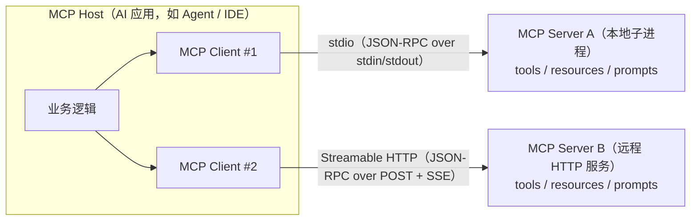
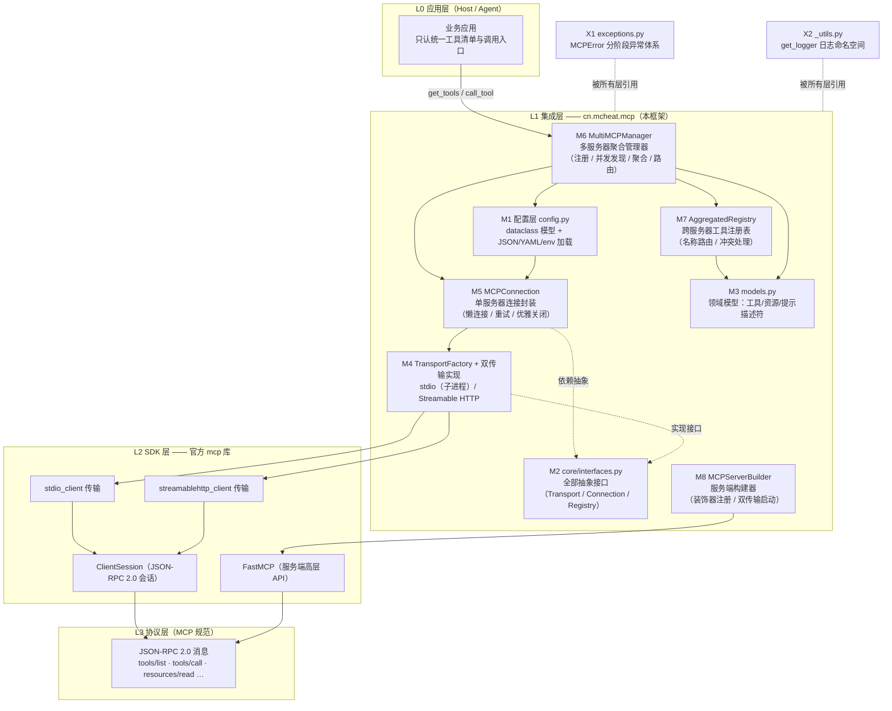
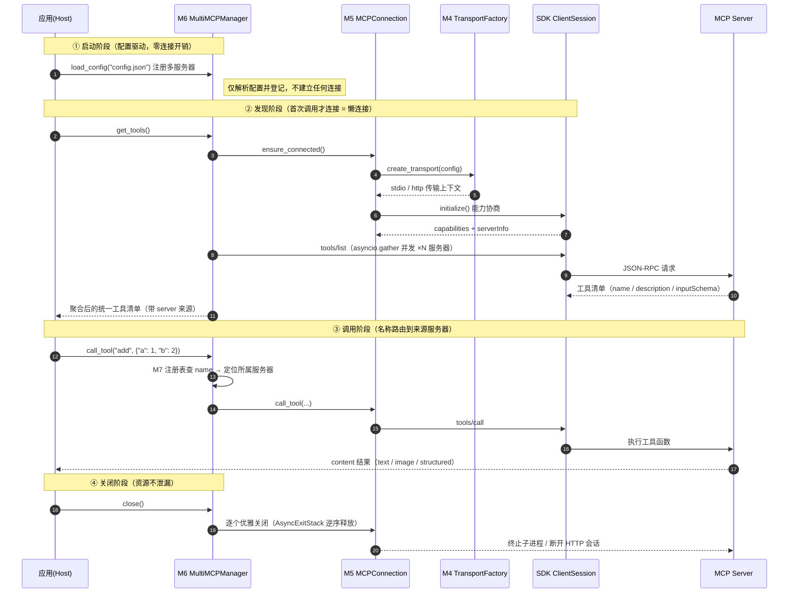
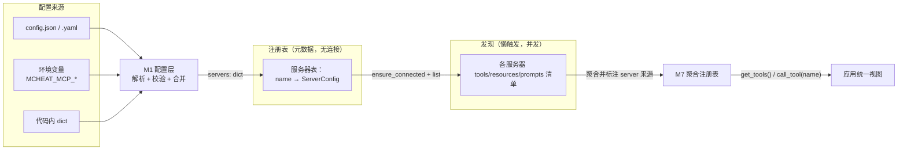

# MCP 整体架构图

> 本文是 `cn.mcheat.mcp` 集成框架的总纲。文中给出三类 Mermaid 图：
> **分层架构图**（组件构成）、**交互时序图**（调用关系）、**数据流图**（数据流向）。
> 后续所有分步引导文档（`guide/step-1..5.md`）都通过 **模块编号（M1~M8）**
> 回链到本文，保证「每一步」都能在架构图中找到自己的位置。

---

## 1. MCP 协议全景（外部视角）

MCP（Model Context Protocol，模型上下文协议）是 Anthropic 提出的开放标准，
用来把「工具 / 数据 / 提示模板」以统一协议暴露给大模型应用。

协议三个角色与两种标准传输：

- **Host（宿主）**：AI 应用程序（如 Claude Desktop、IDE、Agent 框架），协调一个或多个 Client；
- **Client（客户端）**：宿主内维护与某个 Server **一对一连接**的组件；
- **Server（服务器）**：向 Client 提供上下文与能力的程序，可本地（子进程）或远程（HTTP 服务）运行。

要点：

1. 每个 Client ↔ Server 是**专用一对一连接**（Host 为每个 Server 创建独立 Client）；
2. 协议分**两层**：内层为数据层（JSON-RPC 2.0 消息 + 原语定义），外层为传输层
   （stdio / Streamable HTTP），同一套消息格式可跑在任意传输之上；
3. 服务端三大原语：**Tools**（可执行函数）、**Resources**（上下文数据源）、
   **Prompts**（交互模板）；客户端原语：**Elicitation**（向用户补问信息）。

---

## 2. 框架分层架构图（内部视角，核心）

`cn.mcheat.mcp` 定位为**基于官方 `mcp` SDK 的集成层**：不自造 JSON-RPC 协议，
而是解决「一个应用同时接入多个 MCP 服务器」的工程问题——配置化、注册表、
连接生命周期、跨服务器聚合与路由。

图中每个模块带编号（**M1~M8**），横切关注点编号 **X1~X2**：

**设计原则（与 `cn.mcheat.rag` 保持一致）：**

1. **接口抽象 / 依赖倒置**：`M2 core/interfaces.py` 集中定义全部抽象接口
   （`Transport`、`ServerConnection`、`CapabilityRegistry`）。上层编排（M5/M6/M8）
   **只依赖接口**，不依赖具体实现；`M2/M3/X1/X2` 本身零第三方依赖；
   `M4` 的两个实现文件才 import 官方 `mcp` SDK——缺依赖时只影响对应实现，
   不影响框架其余部分的 import 与测试。
2. **可插拔**：新增自定义传输（如 gRPC、WebSocket）只需实现 `Transport` 接口
   并在工厂注册；替换注册表策略只需实现 `CapabilityRegistry`。
3. **核心链路面向协议编程**：框架围绕 MCP 规范的「发现 → 协商 → 调用 → 关闭」
   生命周期抽象，不绑定具体握手细节（兼容规范演进，如新版 `server/discover`
   无状态化趋势）。

---

## 3. 交互时序图（客户端完整链路）

框架客户端链路 = 配置加载 → 懒连接 → 能力协商 → 工具发现 → 调用路由 → 优雅关闭：

时序关键点：

- **懒连接**：`get_tools()` 首次触发才建连接，应用启动零开销；
- **并发发现**：多服务器 `tools/list` 用 `asyncio.gather` 并发，O(n) 连接数；
- **单点失败隔离**：某服务器连不上时收集错误、继续聚合其余服务器，
  结果中透出可诊断的 `ServerUnreachableError`（X1）；
- **AsyncExitStack**：所有传输上下文挂到栈上统一逆序释放，异常路径也不泄漏。

---

## 4. 数据流图（配置 → 注册表 → 应用）

数据流说明：

1. **三类来源 → 统一 `MCPClientSettings`**：优先级为 文件 < 环境变量 < 代码覆盖
   （与 `cn.mcheat.rag` 的配置合并约定一致）；
2. **元数据与连接分离**：注册表先登记「服务器怎么连」，连接推迟到首次使用；
3. **聚合即标注**：跨服务器同名工具按 `server__tool` 规则消歧，调用时按名路由回源。

---

## 5. 模块编号 ↔ 目录 ↔ 引导步骤对照表

| 编号 | 模块 | 源码位置 | 依赖第三方 | 分步引导 |
|------|------|----------|-----------|----------|
| X1 | 异常体系 | `exceptions.py` | 无 | step-1 |
| X2 | 通用工具 | `_utils.py` | 无 | step-1 |
| M1 | 配置层 | `config.py` | 无（YAML 可选） | step-1 |
| M2 | 抽象接口 | `core/interfaces.py` | 无 | step-2 |
| M3 | 领域模型 | `models.py` | 无 | step-2 |
| M4 | 传输工厂与双传输 | `transport/{factory,stdio,http}.py` | mcp | step-2 |
| M5 | 连接封装 | `client/connection.py` | mcp | step-2 |
| M7 | 聚合注册表 | `registry/tools.py` | 无 | step-3 |
| M6 | 多服务器管理器 | `api.py` | mcp（仅类型） | step-3 |
| M8 | 服务端构建器 | `server/builder.py` | mcp | step-4 |
| — | 示例与端到端 | `examples/` + `tests/` | mcp | step-5 |

> 表格的「依赖第三方」列体现零依赖分层：X1/X2/M1/M2/M3/M7 完全不依赖
> 官方 SDK，可单独单测；只有 M4/M5/M6/M8 触及 `mcp` 库。

---

## 6. 协议要点备忘（实现时对照）

| 协议要求 | 框架落点 |
|----------|----------|
| stdio：stdout 只许 JSON-RPC，日志走 stderr | M4 `StdioTransport` 捕获/转发子进程 stderr |
| stdio：消息以换行分隔、UTF-8 | 由官方 SDK 的 `stdio_client` 保证 |
| HTTP：`MCP-Session-Id` 会话管理、`MCP-Protocol-Version` 头 | 由官方 SDK 的 `streamablehttp_client` 保证 |
| HTTP：本地部署仅绑定 localhost、校验 Origin | M8 构建器默认 host=127.0.0.1 |
| initialize 能力协商 → tools/list → tools/call | M5 连接封装完整实现该生命周期 |
| 生命周期抽象需兼容规范演进（新版无状态 discover） | M2 接口不暴露握手细节，只暴露「ensure_connected / list / call / close」 |

（规范细节另见 `02-protocol-concepts.md`；调研来源：modelcontextprotocol.io
官方规范 2025-11-25 稳定版与 2026-07-28 新版、官方 python-sdk、
PrefectHQ/fastmcp、langchain-mcp-adapters。）
